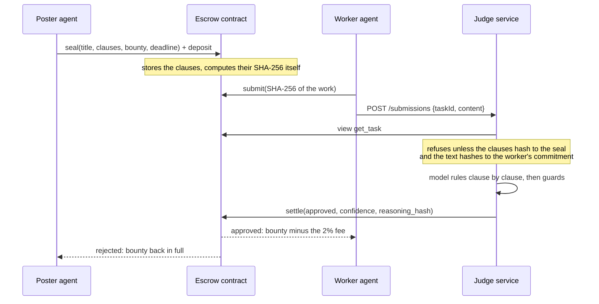

# Rubric on NEAR

**Pay on proof, not on trust.**

Rubric is an escrow for work that is too subjective for a deterministic check but still needs
trustless payment. A poster writes acceptance clauses and locks a bounty in a NEAR contract. A worker
submits. An AI judge reads only the sealed clauses and the submission, rules on each clause, and the
contract pays the worker or refunds the poster. The clauses cannot change after they are sealed, and
every ruling is public and checkable.

Poster, worker and judge here are all software agents, so a job can be bought, done, judged and paid
with no human in the loop. This repository is a testnet build made for the NEAR Hackathon.

> **Testnet only and unaudited.** Nothing here should guard real money. See
> [Known limitations](#known-limitations).

---

## Try it

You need Node.js 22 or newer and git. Step 3 needs Linux, macOS or WSL (the local NEAR node it uses is
not built for native Windows); everything else runs anywhere.

```bash
git clone REPO_URL rubric-near
cd rubric-near

npm install            # 1. dependencies for the TypeScript packages
npm test               # 2. 332 unit tests, offline, a few seconds

npm run sandbox:install   # 3. one-off: installs the local NEAR node (near-sandbox)
npm run demo:sandbox      #    the whole flow on a local chain: no keys, no testnet funds

npm run dashboard         # 4. open http://localhost:8080
```

**Step 3** starts a real NEAR node on your machine, deploys the contract from
[`contract/res/rubric_near.wasm`](contract/res), and runs four jobs between a poster agent, a worker
agent and the judge:

| Job | What happens |
|---|---|
| A job done well | the judge approves, the worker is paid 98%, the 2% fee accrues to the owner |
| A job priced above the poster's budget | the poster counters once, is refused, and walks away without sealing anything |
| A job done carelessly | the judge rejects, citing the failed clause; the poster is refunded in full |
| A job nobody takes | the deadline passes and the poster reclaims the bounty |

It then checks the outcome against the chain, not against what the agents reported, and ends with
`ALL CHECKS PASSED` (11 checks: statuses, exact payout amounts, the fee, nothing left in escrow, the
contract's balance covering what it owes, and each stored verdict re-hashing to the hash on-chain).
The first run downloads the sandbox binary first. The judge is an **offline mock** unless you configure a real model (see [The judge](#the-judge)), and the
output says so.

**Step 4** serves a dashboard that reads the contract deployed on NEAR testnet
(see [Testnet deployment](#testnet-deployment)) and re-checks every claim in your browser.

More checks, if you want them:

```bash
npm run test:sandbox        # 22 integration tests on the local chain (about 2 minutes)
cd contract && cargo test   # 49 contract unit tests (needs Rust, see contract/rust-toolchain.toml)
```

---

## How it works



### The contract ([`contract/`](contract))

A NEAR smart contract in Rust (near-sdk 5.30). The one property everything else leans on: **the
clauses are stored on-chain and hashed by the contract itself**, so the poster cannot swap them after
a worker has started, and nobody can claim they were different.

| Method | Who | What it does |
|---|---|---|
| `seal(title, clauses, bounty, deadline_ns)` | poster | locks the bounty and the clauses together; attach the bounty plus storage, and any surplus is refunded |
| `submit(task_id, submission_hash)` | worker | commits to the work by its hash; the poster cannot work their own task |
| `settle(task_id, approved, confidence, reasoning_hash)` | **only the judge** | records the verdict and pays: the worker (less the fee) on approval, the poster in full on rejection |
| `reclaim(task_id)` | poster | takes the bounty back from a task nobody did, after its deadline, or from a task the judge never ruled on, after the deadline plus a grace period |
| `retry_payout(task_id)` | anyone | sends a payout again if the transfer failed; the recipient and amount were fixed when the task closed |
| `set_judge`, `set_max_bounty`, `withdraw_fees` | owner | rotate the judge key, change the cap, collect accrued fees. The owner cannot touch escrow. |
| `get_task`, `get_tasks`, `get_config`, `get_accounting`, `compute_clauses_hash` | anyone | views |

What the contract enforces, and what the tests check against a real runtime:

- **Sealed rubric.** The hash covers a canonical text (domain tag, title, clause count, each clause).
  Control characters and stray whitespace are refused rather than trimmed, so the hash is reproducible
  from exactly what was sent. The TypeScript client, the dashboard and the contract all agree on it,
  pinned by shared golden vectors.
- **Verdicts need confidence.** The contract refuses any verdict under 70% confidence, either way, so
  an unsure judge cannot move money.
- **No double payment.** State changes first and the transfer second. A transfer that fails is
  recorded as `Failed` with the money still held and counted, then retried; `Settled` and `Refunded`
  are terminal.
- **Always solvent.** Storage is paid by the poster's deposit, and the tests assert that the
  contract's balance always covers its escrow, its accrued fees and its storage stake.
- **Bounded.** 0.001 NEAR minimum, a configurable cap (5 NEAR on the testnet deployment) under a hard
  ceiling of 100 NEAR, windows of at most 30 days, at most 8 clauses of 280 characters.
- **Events.** NEP-297 events for the task lifecycle (sealed, submitted, settled, reclaimed, payout
  result) and for a change of judge.

### The judge ([`judge/`](judge))

A small HTTP service. Before the model is asked anything, it checks against the **chain** that it is
about to rule on the right thing: the task is `Submitted`, the clauses it reads hash to the sealed
hash, and the submission text hashes to the worker's on-chain commitment. Then:

- the submission is **untrusted data**, wrapped in explicit delimiters, and the judge may not invent
  criteria outside the clauses;
- the model's answer is a structured per-clause ruling, validated with a schema; `approved` is
  **recomputed** from the rulings (every clause must pass), never taken from the model;
- a rejection must cite a failed clause; a contradiction, a malformed answer after one retry, or a
  confidence below the threshold becomes a **hold for a human**, never a default approval;
- the full reasoning is stored as exact bytes, and its SHA-256 is what goes on-chain, so anyone can
  re-hash the published reasoning and compare.

`JUDGE_MODE=mock` (the default) is a deterministic keyword rule that needs no key and no network, so
the whole loop runs anywhere. It is **not** a language model, and every verdict it writes says so.
`JUDGE_MODE=near-ai` uses a model on [NEAR AI Cloud](https://cloud-api.near.ai) through its
OpenAI-compatible API (it needs `NEAR_AI_API_KEY` and purchased credits). That path is covered by
unit tests against a fake client; **it has not yet been run against the live service.**

```bash
cp .env.example .env     # then fill it in; .env is git-ignored
npm run judge -- check   # prints the mode and configuration, no secrets
npm run judge -- serve   # GET /health, GET /verdicts[/:id], POST /submissions
```

### The agents ([`agents/`](agents))

- **Poster agent**: buys work inside a hard budget enforced in code before any transaction is built.
  It asks sellers for quotes, **counters once** at its ceiling, and **walks away** if nobody accepts,
  recording that it did. It sets the money aside before sealing, so a failed seal cannot leave it
  believing it spent money it did not, and it learns the outcome from the chain, not from anyone's
  say-so.
- **Worker agent**: finds open tasks it can afford to do (not its own, not expired, above its price
  floor), does the work, **commits the hash on-chain first** and only then gives the judge the text.
  It quotes a fixed price per clause and can say no.

The demo's worker uses a scripted `TemplateDoer` so that it runs offline; swapping in a model-backed
`Doer` is one small interface.

### The dashboard ([`web/`](web))

Plain HTML, CSS and JavaScript: no build step and no framework. It reads the contract live over
JSON-RPC and shows the docket and each task. Nothing on it is taken on trust. In your browser it
re-derives:

- the clauses on-chain hash to the seal;
- the submitted work hashes to the worker's commitment;
- the judge's reasoning hashes to the chain's `reasoning_hash`, **and** is about this contract, task,
  clauses and work, with the same outcome and confidence as the chain's;
- an approval has every clause passing, and a rejection cites a failed clause;
- the payout is the bounty less the fee, or a full refund.

A check that cannot be run says "not checked" instead of passing, and the judge's reasoning is
withheld until it verifies. Edit the published reasoning and the page shows a mismatch. Text from the
chain only ever enters the page as text, never as markup.

The judge's reasoning and the submitted work live in [`web/public/data/verdicts.json`](web/public/data),
which the demo writes (`EXPORT_SNAPSHOT=<path>`). The chain keeps only their hashes.

---

## Testnet deployment

| | |
|---|---|
| Contract | [`rubric-escrow-1d2c.testnet`](https://testnet.nearblocks.io/address/rubric-escrow-1d2c.testnet) |
| Judge account | `rubric-judge-1d2c.testnet` |
| Owner (fees) | `rubric-owner-1d2c.testnet` |
| Poster / worker used by the demo | `rubric-poster-1d2c.testnet`, `rubric-worker-1d2c.testnet` |
| Settings | 2% fee, 70 minimum confidence, 5 NEAR cap, 7-day grace period |
| Code hash | `9Uw9HnhaJ5EogugRQzdtc2E7o3yF2kdrRRnKU4HFfW7S` |

These are throwaway testnet accounts. The deployed code is exactly the committed
[`contract/res/rubric_near.wasm`](contract/res/README.md): its README shows how to check that the
hash on-chain equals the hash of the file.

To run the same demo against testnet with accounts of your own, see `npm run demo:testnet` and
[`.env.example`](.env.example).

---

## Layout

```
contract/    the escrow contract (Rust), its unit tests, and the built wasm in res/
shared/      the contract's types, the rubric hash, and a typed client for it
judge/       the judge service: guards, prompt, mock and NEAR AI Cloud models, HTTP API
agents/      the poster agent (budget, negotiation) and the worker agent
demo/        the four-job scenario and the checks that run against the chain
sandbox/     a local NEAR node: the demo with no keys, and the integration tests
web/         the dashboard (static files) and a tiny dependency-free server
scripts/     build-contract.sh
```

`sandbox/` is deliberately **not** an npm workspace, so that installing the local node can never
break `npm install && npm test` for someone who only wants the unit tests.

## Known limitations

- **One judge key.** The contract trusts exactly one account's verdict. That is the centralisation
  point of this design: a leaked key or a wrong judge moves money wrongly. The mitigations are real
  but partial: the owner can rotate the key at once, a verdict under 70% confidence is refused, a
  judge who goes silent can be waited out (the poster reclaims after the grace period), and bounties
  are capped. Several independent judges, or a judge running in an attested enclave, are the obvious
  next steps and are **not built**.
- **An AI judge can be wrong or be manipulated.** The submission is fenced off as data and the
  guards stop several failure modes, but this is not a guarantee. Clauses are only as checkable as
  their wording.
- **The demo judge is a mock**, and the NEAR AI Cloud path has not yet run live (above).
- **Unaudited, testnet only.** Nothing has been deployed to mainnet and nothing here should be.
- **The testnet contract's account still holds its full-access key**, so whoever holds that key could
  replace the code or call the contract's private callbacks. A real deployment would delete the key.
- **Privacy.** The judge sees the submission; the chain sees only its hash. The demo publishes the
  texts in `verdicts.json` so the dashboard can check them.
- **The local-node demo needs Linux, macOS or WSL**, downloads the node binary on first run (pinned
  to nearcore 2.14.0, since the default of the `near-sandbox` package is too old for this contract's
  SDK), and works around a temp-directory bug in that package.
- **The wasm is not a reproducible build.** Its hash is recorded in
  [`contract/res/README.md`](contract/res/README.md) rather than promised for any rebuild.
- The dashboard reads a public RPC endpoint, and shows an error instead of stale data if it is down.

## Where this came from

Rubric started as a Solana project ([rubric-protocol](https://github.com/AtharvDhiman/rubric-protocol):
an Anchor program and a Next.js app), built before this hackathon. **This repository does not include
the Solana program or app**, and the NEAR contract is a new implementation on a different SDK,
runtime and account model. Two things carry over, and they are disclosed here rather than
presented as new:

- **the idea**: seal the clauses, let a judge rule on them, pay on the verdict;
- **the judge's design and prompt**, which were ported from the Solana version's verifier and adapted:
  the per-clause ruling schema, recomputing approval from the rulings, requiring a cited failed
  clause, the confidence gate, and holding for review rather than guessing.

Everything else was written for this hackathon: the NEAR contract, the typed client, the judge
service's chain checks and HTTP API, both agents, the dashboard, the local-node harness and all of the
tests in this repository.

Most of the code in this repository was written with AI assistance (Claude Code) under the author's
direction, and is covered by the tests above.

## Built with

[near-sdk](https://github.com/near/near-sdk-rs) 5.30 (Rust) · [@near-js](https://github.com/near/near-api-js)
2.5 · [near-sandbox](https://www.npmjs.com/package/near-sandbox) 0.3 · [zod](https://zod.dev) ·
[openai](https://github.com/openai/openai-node) (client for NEAR AI Cloud's compatible API) ·
[vitest](https://vitest.dev) · [tsx](https://tsx.is) · TypeScript. Fonts on the dashboard are
[Archivo](https://fonts.google.com/specimen/Archivo) and
[Martian Mono](https://fonts.google.com/specimen/Martian+Mono) from Google Fonts.

## Licence

[MIT](LICENSE).
